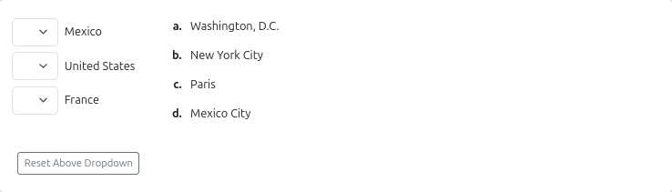
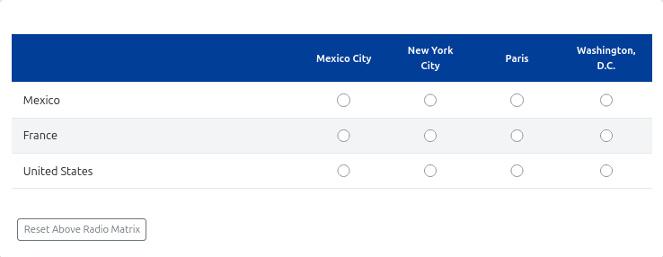

# `pl-matching` element

Given a list of statements, select a matching option for each entry from a dropdown list or a radio matrix

## Sample element



### Default Dropdown Display

```html title="question.html"
<pl-matching answers-name="string_value">
  <pl-statement match="Washington, D.C.">United States</pl-statement>
  <pl-statement match="Mexico City">Mexico</pl-statement>
  <pl-statement match="Paris">France</pl-statement>

  <pl-option>New York City</pl-option>
</pl-matching>
```

### Radio-Matrix Display



```html title="question.html"
<pl-matching answers-name="string_value" display="radio-matrix">
  <pl-statement match="Washington, D.C.">United States</pl-statement>
  <pl-statement match="Mexico City">Mexico</pl-statement>
  <pl-statement match="Paris">France</pl-statement>

  <pl-option>New York City</pl-option>
</pl-matching>
```

## Customizations

| Attribute             | Type                                                           | Default         | Description                                                                                                                                                                                                              |
| --------------------- | -------------------------------------------------------------- | --------------- | ------------------------------------------------------------------------------------------------------------------------------------------------------------------------------------------------------------------------ |
| `allow-blank`         | boolean                                                        | false           | Whether a blank submission is allowed. If this is set to true, a statement that selects the blank entry will be marked as incorrect instead of invalid.                                                                  |
| `answers-name`        | string                                                         | —               | Variable name to store data in. Note that this attribute has to be unique within a question, i.e., no value for this attribute should be repeated within a question.                                                     |
| `aria-label` | string | "Matching element" | An accessible label for the element. |
| `blank`               | boolean                                                        | true            | Option to add blank dropdown entry as the default selection in each dropdown list. This parameter is only applicable when `display="dropdown"`                                                                                                                                      |
| `builtin-grading` | boolean | true | Whether the element performs its own grading. If false, any required grading must be performed explicitly through other means, and the `match` attribute is not required in its children elements such as `pl-statement`. See [Disabling built-in grading](#disabling-built-in-grading) for details. |
| `counter-type`        | `"decimal"`, `"lower-alpha"`, `"upper-alpha"` or `"full-text"` | `"lower-alpha"` | The type of counter to use when enumerating the options. If set to `"full-text"`, the column of options will be hidden, and the text of each option will be used in the statements' dropdown lists, instead of counters. This parameter is only applicable when `display="dropdown"`  |
| `display` | `"dropdown"` or `"radio-matrix"` | `"dropdown"` | Controls the display style of the element. **Defaults** to `dropdown`. The `dropdown` provides a dropdown list of options for each statement, while `radio-matrix` horizontally aligns all options with a radio button for each. **Note**: Some parameters are not applicable to `radio-matrix` or `dropdown`. |
| `fixed-options-order` | boolean                                                        | false           | Whether to display the options in a fixed order; otherwise they are shuffled. See the details of `pl-option` below for more information on option ordering.                                                              |
| `fixed-order`         | boolean                                                        | false           | Whether to display the statements in a fixed order; otherwise they are shuffled.                                                                                                                                         |
| `hide-score-badge`    | boolean                                                        | false           | Whether to hide the correct/incorrect score badge next to each graded answer choice.                                                                                                                                     |
| `max-response-per-option`  | integer | - | Maxmimum number of selection per option. Choosing above the max response will result in an invalid not gradeable submission.   |
| `min-response-per-option`  | integer | - | Minimum number of selection per option. Choosing below the min response will result in an invalid not gradeable submission.   |
| `none-of-the-above`   | boolean                                                        | false           | Whether to add a "None of the above" to the end of the options.                                                                                                                                                    |
| `number-options`      | integer                                                        | See description | The number of options to display. Defaults to all options. The `none-of-the-above` option does not count towards this number. This parameter is only applicable when `display="dropdown"` |                                                                                   
| `number-statements`   | integer                                                        | See description | The number of statements to display. Defaults to all statements.    This parameter is only applicable when `display="dropdown"` |                                                                                                                      
| `options-placement`   | `"right"` or `"bottom"`                                        | `"right"`       | The placement of options relative to the statements in order to make it visually cohesive. Especially useful when dealing with long statements or options. This parameter is only applicable when `display="dropdown"` |
| `partial-credit`      | boolean                                                        | true            | Whether to award proportional partial credit for each correctly matched statement. If false, the element awards full credit only when every statement is matched correctly.                                              |
| `preset-options` | `"agreement-4"`, `"agreement-5"`, `"agreement-6"`or `"agreement-7"` | - | Optional preset for common scales (e.g. Likert scale). Defaults to None. Note that `preset-options` attribute and `pl-options` tags are  **mutually exclusive**. Providing both of them will throw an error. See [ Preset Options](#preset-options-preset-options) for details. This parameter is only applicable when `display="radio-matrix"` |
| `radio-matrix-statement-column-width` | CSS Length Value string (e.g. "10%", "100px") | "40%" | Defines the width of the statement column (the first column) when `display="radio-matrix"`. |
| `repeat-header` | integer or comma-separated list of integers | None | When using the 'radio-matrix' display, this attribute controls the maximum number of rows per statement group. This allows you to split a large radio-matrix into several smaller ones. For example, `repeat-header="1,3"` defines a repeating pattern: Group 1 (1 row), Group 2 (3 rows), Group 3 (1 row), Group 4 (3 rows), etc. Defaults to None (i.e., all statements will be contained in a single radio-matrix). This parameter is only applicable when `display="radio-matrix"`    |
| `reset-button` | boolean | false | Whether there is a reset button that resets input back to default. |
| `show-help-text` | boolean | false | Whether there is a help button that displays instructions. |
| `weight`              | integer                                                        | 1               | Weight to use when computing a weighted average score over elements.                                                                                                                                                     |

## Child Elements

Inside the `pl-matching` element, a series of `pl-statement` and `pl-option` elements specify the questions the student must answer and the options to which they can be matched, respectively. Statements are displayed in the left column, and options in the right.

A total of `number-statements` statements will be randomly selected and displayed to the student. The corresponding matching options will be gathered; if `number-options` is larger than the number of options used by the selected statements, then random distractors will be selected from the remaining unused options. If the selected statements require more options than `number-options`, then `none-of-the-above` will automatically be set to true.

## `pl-statement`

The content of a `pl-statement` can be any HTML element, including other PrairieLearn elements. A `pl-statement` must be specified with these attributes:

| Attribute | Type   | Default | Description                                                                                                                                                                                                                                                         |
| --------- | ------ | ------- | ------------------------------------------------------------------------------------------------------------------------------------------------------------------------------------------------------------------------------------------------------------------- |
| `match`   | string | —       | Identifies the option as the correct response for this `pl-statement`. If `match` corresponds to the `name` of any `pl-option` element, the statement will be linked to that `pl-option`, otherwise a new option is implicitly created based on this `match` value. This is not required when `builtin-grading` is false.|

The content of a `pl-option` can be any HTML element, including other PrairieLearn elements. `pl-option` elements are optional; options are created by default based on the `match` attribute of each `pl-statement`. Additional `pl-option` elements can be added to serve as distractors, or to render formatted HTML/PrairieLearn elements instead of plain text.

When the `fixed-options-order` feature is used, options are shown in the following order:

1. Any explicitly-defined `pl-option` elements are shown first, in the order they are declared.
2. Any implicitly-defined options defined by a `pl-statement` `match` attribute are shown next, in the order they are declared.

### Warning
  While it is possible to use implicit options from the `match` attribute of each `pl-statement` without defining any `pl-option` elements, it is recommended to define `pl-option` elements explicitly in the following cases:

  * To define distractor options that are not the correct answer to any statement (an option that is always incorrect, such as "New York City" in the example above).
  * When the option text is longer than a few words, or requires formatting (e.g., mathematical expressions, code, images, etc.). In such cases, the `pl-option` name is used to identify the correct answer, while the content of the `pl-option` element is used to display the option text. The use of `counter-type="full-text"` is not recommended in this case.
  * When using `fixed-options-order="true"` to ensure the order of options is exactly as intended.
  * When the statements and options are generated dynamically in `server.py`, to ensure that the correct options are always available.
  Explicit options may be defined as the example below. Note that the `name` attribute is used to link the option to a statement's `match` attribute.
  ```html
  <pl-matching answers-name="string_value">
    <pl-statement match="golden">$\Phi$</pl-statement>
    <pl-statement match="e">$e$</pl-statement>
    <pl-statement match="i">$i$</pl-statement>
    <pl-option name="golden">$\frac{1+\sqrt{5}}{2}$</pl-option>
    <pl-option name="e">$\lim_{n \to \infty} \left(1 + \frac{1}{n}\right)^{n}$</pl-option>
    <pl-option name="i">$\sqrt{-1}$</pl-option>
  </pl-matching>
  ```

### `pl-option`

A `pl-option` must be specified with these attributes:

| Attribute | Type   | Default         | Description                                                                                                                 |
| --------- | ------ | --------------- | --------------------------------------------------------------------------------------------------------------------------- |
| `name`    | string | See description | A key used to match this option as the correct response to a `pl-statement`. Defaults to the inner HTML of the `pl-option`. |

## Disabling built-in grading

Setting `builtin-grading="false"` causes the element to display choices and collect submissions without awarding any points on its own. This is useful in scenarios such as:

- **Survey-style questions** where there is no single correct answer.
- **Multi-element dependencies** where the correct answer depends on other elements and must be evaluated together.
- **Complex or manual grading** where correctness requires logic beyond simple answer matching.

When `builtin-grading="false"` is set:

- The child `pl-statement` elements should **not** have the `match` attribute. 
- The element does **not** require any answer to be marked as `correct`.
- The element does **not** produce a score. To grade submissions automatically, you must supply a [`grade()` function in `server.py`](../question/server.md#step-5-grade) or be evaluated by an [external grader](../externalGrading.md). Without one, the score will be based on other gradable elements in the question (or receive a score of zero if there are no other elements).
- The **answer panel** will not display a correct answer, even if the element is marked as `correct`.
- **Score badges** are not shown by default, since no score is produced by the element.
- The `weight` and `hide-score-badge` attributes **cannot** be used alongside `builtin-grading="false"`.

## Preset Options `preset-options`

You can use the following predefined presets for common options like Likert agreement-disagreement scale. Note that `preset-options` attribute and `pl-options` tags are  mutually exclusive. Providing both of them will throw an error. The default preset is `None`.

| Name | Scale Values |
| -- | -- | 
| `"agreement-4"` | "Strongly Disagree", "Disagree", "Agree", "Strongly Agree" |
| `"agreement-5"` | "Strongly Disagree", "Disagree", "Neutral", "Agree", "Strongly Agree" |
| `"agreement-6"` | "Strongly Disagree", "Disagree", "Somewhat Disagree", "Somewhat Agree", "Agree", "Strongly Agree" |
| `"agreement-7"` | "Strongly Disagree", "Disagree", "Somewhat Disagree", "Neutral", "Somewhat Agree", "Agree", "Strongly Agree" |
| `"satisfaction-4"` | "Strongly Dissatisfied", "Dissatisfied", "Satisfied", "Strongly Satisfied" |
| `"satisfaction-5"` | "Strongly Dissatisfied", "Dissatisfied", "Neutral", "Satisfied", "Strongly Satisfied" |
| `"satisfaction-6"` | "Strongly Dissatisfied", "Dissatisfied", "Somewhat Dissatisfied", "Somewhat Satisfied", "Satisfied", "Strongly Satisfied" |
| `"satisfaction-7"` | "Strongly Dissatisfied", "Dissatisfied", "Somewhat Dissatisfied", "Neutral", "Somewhat Satisfied", "Satisfied", "Strongly Satisfied" |
| `"quality-4"` | "Poor", "Inadequate", "Great", "Excellent" |
| `"quality-5"` | "Poor", "Inadequate", "Average", "Great", "Excellent" |
| `"quality-6"` | "Poor", "Inadequate", "Below Average", "Above Average", "Great", "Excellent" |
| `"quality-7"` | "Poor", "Inadequate", "Below Average", "Average", "Above Average", "Great", "Excellent" |
| `"likelihood-4"` | "Very Unlikely", "Unlikely", "Likely", "Very Likely" |
| `"likelihood-5"` | "Very Unlikely", "Unlikely", "Neutral", "Likely", "Very Likely" |
| `"likelihood-6"` | "Very Unlikely", "Unlikely", "Somewhat Unlikely", "Somewhat Likely", "Likely", "Very Likely" |
| `"likelihood-7"` | "Very Unlikely", "Unlikely", "Somewhat Unlikely", "Neutral", "Somewhat Likely", "Likely", "Very Likely" |
| `"frequency-4"` | "Never", "Rarely", "Often", "Always" |
| `"frequency-5"` | "Never", "Rarely", "Sometimes", "Often", "Always" |
| `"frequency-6"` | "Never", "Rarely", "Infrequently", "Frequently", "Often", "Always" |
| `"frequency-7"` | "Never", "Rarely", "Infrequently", "Sometimes", "Frequently", "Often", "Always" |

## Example implementations

- [element/matching]

---

[element/matching]: https://github.com/PrairieLearn/PrairieLearn/tree/master/exampleCourse/questions/element/matching